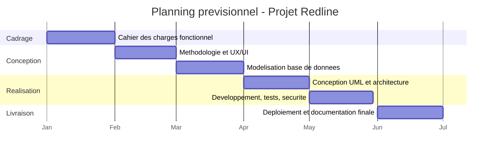
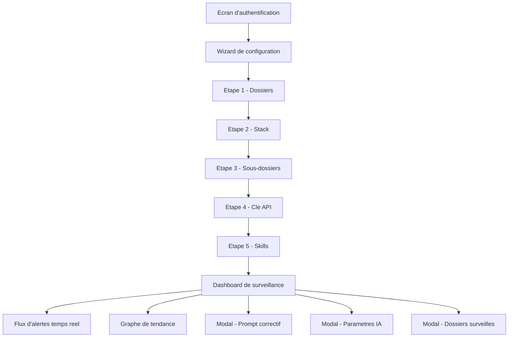

# Méthodologie & Conception UX/UI - Projet Redline

> **Projet Fil Rouge - Bachelor 3 Développement**
> Jalon 2 - Méthodologie d'organisation et conception UI/UX
>
> **Auteur :** Badirou Mohamed Yecir
> **Formation :** Bachelor 3 Développement - IPSSI
> **Date :** [à compléter]
> **Version :** 1.0

---

## Sommaire

**Partie A - Méthodologie et organisation**
1. [Méthode de gestion de projet](#1-méthode-de-gestion-de-projet)
2. [Planning (macro-planning)](#2-planning-macro-planning)
3. [Outils de suivi](#3-outils-de-suivi)
4. [Gestion du code source (Git)](#4-gestion-du-code-source-git)
5. [CI/CD planifié](#5-cicd-planifié)

**Partie B - Conception UX/UI**
6. [Arborescence et zoning](#6-arborescence-et-zoning)
7. [Wireframes (basse fidélité)](#7-wireframes-basse-fidélité)
8. [Charte graphique](#8-charte-graphique)
9. [Maquettes haute fidélité](#9-maquettes-haute-fidélité)
10. [Considérations UX](#10-considérations-ux)

---

# Partie A - Méthodologie et organisation

## 1. Méthode de gestion de projet

Le projet est piloté selon une approche **agile de type Kanban**, adaptée à un
travail en solo et au découpage mensuel imposé. Chaque jalon est traité comme un
**sprint d'un mois**, avec un objectif clair et un livrable défini.

Justification : le cycle en V serait trop rigide pour un projet exploratoire où
l'UI et le périmètre s'affinent en cours de route. Kanban offre un flux continu de
tâches (À faire → En cours → Terminé) et autorise des ajustements sans cérémonie
lourde. En solo, l'étudiant assume les trois rôles (Product Owner, gestion,
développement) ; un **journal de bord** remplace les réunions Scrum.

## 2. Planning (macro-planning)

| Mois | Sprint / Jalon | Lots de travaux principaux |
|------|----------------|----------------------------|
| Janvier | J1 - Cadrage | Cahier des charges fonctionnel, définition du périmètre |
| Février | J2 - Conception amont | Méthodologie, charte graphique, maquettes UX/UI |
| Mars | J3 - Données | Modélisation MERISE (MCD/MLD/MPD), création de la base |
| Avril | J4 - Architecture | Diagrammes UML, architecture multi-couches, début du développement |
| Mai | J5 - Réalisation | Développement des fonctionnalités, tests, sécurité (version bêta) |
| Juin | J6 - Livraison | Finalisation, dockerisation, déploiement, documentation finale |

### Diagramme de Gantt

## 3. Outils de suivi

- **Tableau Kanban** (GitHub Projects) : colonnes *À faire / En cours / Terminé*,
  une carte par tâche rattachée à une issue.
- **Issues GitHub** : traçabilité des fonctionnalités et des bugs.
- **Revue hebdomadaire** : point d'avancement personnel, réajustement du planning
  en cas de retard ou de repriorisation.

## 4. Gestion du code source (Git)

Stratégie de branches type **GitFlow simplifié** :

- `main` : versions stables, une par jalon (taguée `v0.1`, `v0.2`, … `v1.0`).
- `develop` : branche d'intégration des fonctionnalités en cours.
- `feature/*` : une branche par fonctionnalité ou correctif, fusionnée dans
  `develop` via **pull request** (auto-relecture avant merge).

Conventions : messages de commit explicites (style *Conventional Commits* :
`feat:`, `fix:`, `docs:`…), versionnement des fichiers de configuration (Docker,
CI). Dépôt hébergé sur GitHub.

## 5. CI/CD planifié

Pipeline **GitHub Actions** déclenchée à chaque push :

1. **Lint** : ESLint (moteur/JS) et analyse statique PHP (PHPStan) côté Symfony.
2. **Tests** : PHPUnit (API Symfony) et Vitest (moteur d'analyse).
3. **Build** : construction des images Docker de l'application.
4. **CD (cible)** : sur tag `release` en `main`, publication de l'image et
   déploiement sur l'environnement de démonstration.

Objectif : chaque commit est validé automatiquement (tests au vert) pour détecter
les régressions au plus tôt.

---

# Partie B - Conception UX/UI

## 6. Arborescence et zoning

### 6.1 Arborescence (sitemap)

L'application s'articule en deux temps : un **wizard de configuration**, puis un
**dashboard de surveillance**.

### 6.2 Zoning du dashboard

> **Réalisé sous Figma** - voir le livrable de maquettes (annexe). Le zoning
> décompose l'écran de surveillance en trois zones : une barre supérieure, une
> sidebar (dossiers surveillés + skills par catégorie avec compteurs) et une zone
> principale (graphe de tendance au-dessus, flux d'alertes en dessous).

## 7. Wireframes (basse fidélité)

> **Réalisés sous Figma** - voir le livrable de maquettes (annexe). Les wireframes
> couvrent les écrans clés : authentification, étapes du wizard de configuration,
> et dashboard (avec une alerte dépliée montrant l'extrait de code, l'analyse et
> les actions).

## 8. Charte graphique

L'identité visuelle repose sur une **palette terreuse** et un accent **terracotta**,
choisis pour signaler les alertes sans l'agressivité d'un rouge vif, et pour donner
un rendu chaleureux et professionnel qui se démarque d'un thème générique.

### 8.1 Couleurs (thème clair)

| Rôle | Usage | Code hexadécimal |
|------|-------|------------------|
| Primary (accent) | Boutons, éléments actifs, alertes | `#c0392b` (terracotta) |
| Accent | Accent secondaire, survols | `#d4500a` (orange brûlé) |
| Background | Fond général | `#f5f0e8` (crème) |
| Card | Cartes, panneaux | `#ede7da` |
| Foreground | Texte principal | `#2a1f14` (brun foncé) |
| Muted foreground | Texte secondaire | `#8a7a6a` |
| Border | Bordures | `rgba(42, 31, 20, 0.12)` |

**Couleurs de graphiques** (tendances, catégories) : `#c0392b`, `#d4500a`,
`#c49a2a` (moutarde), `#5a8a3a` (olive), `#3a6a8a` (ardoise).

Un **thème sombre** complet est également défini (fond sombre, contrastes inversés).

### 8.2 Typographie

- **Outfit** (graisses 300 à 700) - police principale de l'interface (titres,
  textes, boutons). Sans-serif géométrique moderne, très lisible.
- **JetBrains Mono** (300 à 500) - police à chasse fixe pour les **extraits de
  code**, garantissant l'alignement et la lisibilité technique.

### 8.3 Autres éléments

- **Rayon de bordure** : `0.375rem` (6 px) - arrondis discrets.
- **Graisse medium** (500) par défaut sur les titres, labels et boutons.
- Animation d'apparition douce (`fadeInUp`) sur les éléments entrants.

## 9. Maquettes haute fidélité

Les maquettes haute fidélité correspondent à l'**interface réelle développée**,
qui applique la charte ci-dessus. La conception initiale a été réalisée sous
**Figma Make** (servant de cahier des charges UI), puis fidèlement implémentée en
React + Tailwind.

> **À intégrer au PDF :** captures d'écran de l'application réelle, en version
> **desktop** et **mobile** (au minimum : écran d'authentification, une étape du
> wizard, le dashboard), afin de démontrer la responsivité.

## 10. Considérations UX

- **Parcours en deux temps** : la configuration (wizard guidé, une décision par
  étape) est séparée de la surveillance (dashboard), pour ne pas noyer
  l'utilisateur.
- **Transparence** : à l'étape Skills, l'utilisateur voit exactement quelles règles
  sont actives - il connaît le périmètre de ce qui est vérifié.
- **Retours visuels clairs** : alertes codées par sévérité (couleur + libellé),
  compteurs de déclenchements, états Actives / Résolues.
- **Responsive** : interface adaptée desktop et mobile (grille flexible, panneaux
  repliables).
- **Accessibilité** : contrastes suffisants entre texte brun foncé et fonds clairs,
  tailles de police confortables (base 16 px).
- **Mode sombre** proposé pour le confort visuel en usage prolongé.

---

*Document rédigé dans le cadre du Jalon 2. Il constitue les chapitres IV
(Méthodologie et organisation) et V (Conception UI/UX) du rapport final.*
