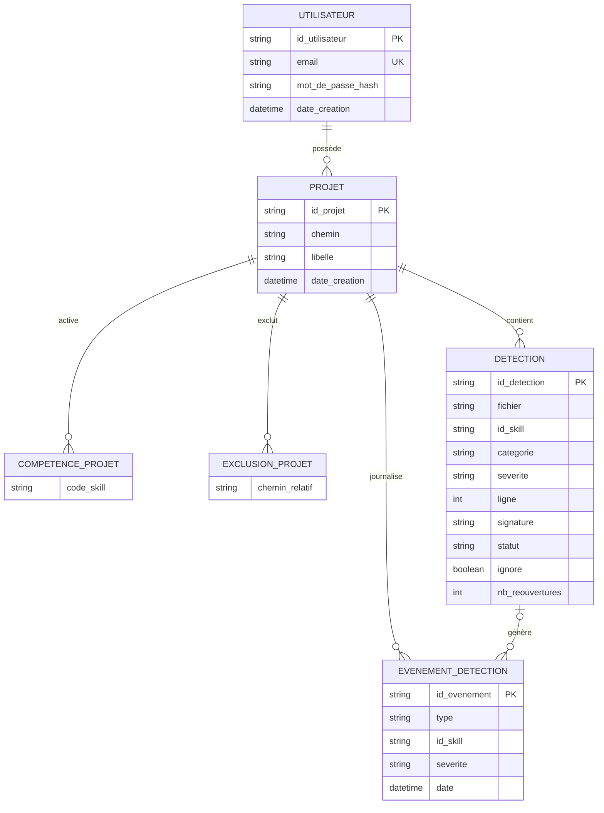

# Modélisation de la Base de Données - Projet Redline

> **Projet Fil Rouge - Bachelor 3 Développement**
> Jalon 3 - Modélisation de la base de données (méthode MERISE)
>
> **Auteur :** Badirou Mohamed Yecir
> **Formation :** Bachelor 3 Développement - IPSSI
> **Date :** [à compléter]
> **Version :** 1.0

---

## Sommaire

1. [Introduction à la méthode MERISE](#1-introduction-à-la-méthode-merise)
2. [Dictionnaire des données](#2-dictionnaire-des-données)
3. [Modèle Conceptuel de Données (MCD)](#3-modèle-conceptuel-de-données-mcd)
4. [Modèle Logique de Données (MLD)](#4-modèle-logique-de-données-mld)
5. [Modèle Physique de Données (MPD)](#5-modèle-physique-de-données-mpd)
6. [Justifications et normalisation](#6-justifications-et-normalisation)

---

## 1. Introduction à la méthode MERISE

Conformément à la méthode MERISE, la modélisation est abordée en trois étapes
successives :

1. **Modèle Conceptuel de Données (MCD)** - représentation abstraite des entités
   métier et de leurs associations, indépendante de toute technologie.
2. **Modèle Logique de Données (MLD)** - traduction du MCD en modèle relationnel
   (tables, clés primaires, clés étrangères).
3. **Modèle Physique de Données (MPD)** - implémentation concrète pour le SGBD
   retenu, ici **PostgreSQL** (types SQL, contraintes, index).

Cette progression du conceptuel vers le physique garantit que la base répond aux
besoins fonctionnels tout en restant optimisée pour le SGBD.

**Rôle de la base dans Redline.** Le moteur d'analyse est *stateless* : il analyse
un fichier et renvoie un rapport, sans rien persister. La base de données ne sert
donc **pas** à stocker le code, mais à conserver l'**historique des détections**
dans le temps - afin d'alimenter les tendances, le temps moyen de résolution
(MTTR) et le suivi des récurrences.

---

## 2. Dictionnaire des données

### Entité UTILISATEUR

| Attribut | Signification | Type logique | Contraintes |
|----------|---------------|--------------|-------------|
| id_utilisateur | Identifiant unique du compte | Chaîne (cuid) | Clé primaire |
| email | Adresse e-mail de connexion | Chaîne | Unique, non nul |
| mot_de_passe_hash | Empreinte du mot de passe (jamais en clair) | Chaîne | Non nul |
| date_creation | Date de création du compte | Horodatage | Non nul, défaut = maintenant |

### Entité PROJET

| Attribut | Signification | Type logique | Contraintes |
|----------|---------------|--------------|-------------|
| id_projet | Identifiant unique du dossier surveillé | Chaîne (cuid) | Clé primaire |
| chemin | Chemin racine du dossier surveillé | Chaîne | Non nul, unique par utilisateur |
| libelle | Nom d'affichage optionnel | Chaîne | Nullable |
| date_creation | Date d'ajout du projet | Horodatage | Non nul, défaut = maintenant |

### Entité COMPETENCE_PROJET (skills activés)

| Attribut | Signification | Type logique | Contraintes |
|----------|---------------|--------------|-------------|
| code_skill | Identifiant d'une règle activée (ex. `sql-injection`) | Chaîne | Partie de clé |

### Entité EXCLUSION_PROJET (sous-dossiers exclus)

| Attribut | Signification | Type logique | Contraintes |
|----------|---------------|--------------|-------------|
| chemin_relatif | Sous-dossier exclu de la surveillance | Chaîne | Partie de clé |

### Entité DETECTION

| Attribut | Signification | Type logique | Contraintes |
|----------|---------------|--------------|-------------|
| id_detection | Identifiant unique de la détection | Chaîne (cuid) | Clé primaire |
| fichier | Fichier concerné (chemin relatif) | Chaîne | Non nul |
| id_skill | Règle à l'origine de la détection | Chaîne | Non nul |
| categorie | Catégorie (security / quality / reliability) | Chaîne | Non nul |
| severite | Gravité (critical / warning / info) | Chaîne | Non nul |
| ligne | Ligne du problème (1-indexée) | Entier | Non nul |
| extrait | Contenu de la ligne fautive | Chaîne | Non nul |
| signature | Signature stable `fichier::skill::extrait` | Chaîne | Unique par projet |
| statut | État de vie (ACTIVE / RESOLVED) | Énumération | Non nul, défaut = ACTIVE |
| ignore | Faux positif assumé par l'utilisateur | Booléen | Non nul, défaut = faux |
| date_premiere_vue | Première apparition | Horodatage | Non nul |
| date_derniere_vue | Dernière apparition | Horodatage | Non nul |
| date_resolution | Date de résolution | Horodatage | Nullable |
| nb_reouvertures | Nombre de réapparitions après résolution | Entier | Non nul, défaut = 0 |

### Entité EVENEMENT_DETECTION (journal horodaté)

| Attribut | Signification | Type logique | Contraintes |
|----------|---------------|--------------|-------------|
| id_evenement | Identifiant unique de l'événement | Chaîne (cuid) | Clé primaire |
| type | Nature de l'événement (APPEARED / RESOLVED / REOPENED) | Énumération | Non nul |
| id_skill | Règle concernée (dénormalisé pour l'analytique) | Chaîne | Non nul |
| severite | Gravité au moment de l'événement | Chaîne | Non nul |
| date | Horodatage de l'événement | Horodatage | Non nul, défaut = maintenant |

---

## 3. Modèle Conceptuel de Données (MCD)

### 3.1 Entités et associations

Le domaine s'articule autour de quatre entités principales :

- **UTILISATEUR** possède ses propres projets (données isolées par compte).
- **PROJET** représente un dossier racine surveillé. Il active des règles
  (COMPETENCE_PROJET) et peut exclure des sous-dossiers (EXCLUSION_PROJET).
- **DETECTION** est l'identité d'un problème détecté, avec son cycle de vie.
- **EVENEMENT_DETECTION** est un journal horodaté (append-only) qui trace chaque
  apparition, résolution ou réouverture, pour alimenter les tendances.

### 3.2 Cardinalités

| Association | Entité A | Cardinalité A | Entité B | Cardinalité B |
|-------------|----------|---------------|----------|---------------|
| possède | UTILISATEUR | (0,n) | PROJET | (1,1) |
| active | PROJET | (0,n) | COMPETENCE_PROJET | (1,1) |
| exclut | PROJET | (0,n) | EXCLUSION_PROJET | (1,1) |
| contient | PROJET | (0,n) | DETECTION | (1,1) |
| journalise | PROJET | (0,n) | EVENEMENT_DETECTION | (1,1) |
| génère | DETECTION | (0,n) | EVENEMENT_DETECTION | (0,1) |

Lecture : *un utilisateur possède de 0 à n projets ; un projet appartient à
exactement un utilisateur*. *Une détection génère de 0 à n événements ; un
événement se rattache à au plus une détection* (un événement de résolution peut
survivre à la suppression de sa détection, d'où le côté optionnel).

### 3.3 Diagramme conceptuel



---

## 4. Modèle Logique de Données (MLD)

Traduction du MCD en tables relationnelles. Notation : `PK` = clé primaire,
`FK` = clé étrangère.

```
UTILISATEUR (id_utilisateur PK, email, mot_de_passe_hash, date_creation)
    UNIQUE (email)

PROJET (id_projet PK, id_utilisateur FK -> UTILISATEUR, chemin, libelle,
        date_creation)
    UNIQUE (id_utilisateur, chemin)

COMPETENCE_PROJET (id_projet FK -> PROJET, code_skill)
    PK (id_projet, code_skill)

EXCLUSION_PROJET (id_projet FK -> PROJET, chemin_relatif)
    PK (id_projet, chemin_relatif)

DETECTION (id_detection PK, id_projet FK -> PROJET, fichier, id_skill, categorie,
           severite, ligne, extrait, signature, statut, ignore,
           date_premiere_vue, date_derniere_vue, date_resolution, nb_reouvertures)
    UNIQUE (id_projet, signature)

EVENEMENT_DETECTION (id_evenement PK, id_projet FK -> PROJET,
                     id_detection FK -> DETECTION (nullable), type, id_skill,
                     severite, date)
```

**Règles de transformation appliquées :**

- Chaque entité du MCD devient une table.
- Les associations *(0,n) - (1,1)* sont traduites par une clé étrangère côté « n »
  (PROJET porte `id_utilisateur` ; DETECTION porte `id_projet` ; etc.).
- Les entités dépendantes multi-valuées (COMPETENCE_PROJET, EXCLUSION_PROJET) ont
  une **clé primaire composite** `(id_projet, valeur)` garantissant l'unicité.
- L'association optionnelle *DETECTION (0,n) - (0,1) EVENEMENT* donne une clé
  étrangère **nullable** `id_detection` dans EVENEMENT_DETECTION.

---

## 5. Modèle Physique de Données (MPD)

Implémentation pour **PostgreSQL**. Les identifiants sont des chaînes générées
côté application (**cuid**), et non des `SERIAL`, afin de rester indépendant du
SGBD et d'éviter les collisions en environnement distribué. Les énumérations
métier sont implémentées via des **types ENUM PostgreSQL**.

```sql
-- Types énumérés
CREATE TYPE detection_status AS ENUM ('ACTIVE', 'RESOLVED');
CREATE TYPE event_type       AS ENUM ('APPEARED', 'RESOLVED', 'REOPENED');

-- Utilisateur
CREATE TABLE utilisateur (
    id_utilisateur      VARCHAR(30)  PRIMARY KEY,
    email               VARCHAR(255) NOT NULL UNIQUE,
    mot_de_passe_hash   VARCHAR(255) NOT NULL,           -- bcrypt
    date_creation       TIMESTAMPTZ  NOT NULL DEFAULT now()
);

-- Projet (dossier surveillé), unique par utilisateur
CREATE TABLE projet (
    id_projet           VARCHAR(30)  PRIMARY KEY,
    id_utilisateur      VARCHAR(30)  NOT NULL
        REFERENCES utilisateur(id_utilisateur) ON DELETE CASCADE,
    chemin              TEXT         NOT NULL,
    libelle             VARCHAR(255),
    date_creation       TIMESTAMPTZ  NOT NULL DEFAULT now(),
    UNIQUE (id_utilisateur, chemin)
);

-- Règles activées par projet
CREATE TABLE competence_projet (
    id_projet           VARCHAR(30)  NOT NULL
        REFERENCES projet(id_projet) ON DELETE CASCADE,
    code_skill          VARCHAR(60)  NOT NULL,
    PRIMARY KEY (id_projet, code_skill)
);

-- Sous-dossiers exclus par projet
CREATE TABLE exclusion_projet (
    id_projet           VARCHAR(30)  NOT NULL
        REFERENCES projet(id_projet) ON DELETE CASCADE,
    chemin_relatif      TEXT         NOT NULL,
    PRIMARY KEY (id_projet, chemin_relatif)
);

-- Détection (identité d'un problème + cycle de vie)
CREATE TABLE detection (
    id_detection        VARCHAR(30)      PRIMARY KEY,
    id_projet           VARCHAR(30)      NOT NULL
        REFERENCES projet(id_projet) ON DELETE CASCADE,
    fichier             TEXT             NOT NULL,
    id_skill            VARCHAR(60)      NOT NULL,
    categorie           VARCHAR(20)      NOT NULL,
    severite            VARCHAR(20)      NOT NULL,
    ligne               INTEGER          NOT NULL,
    extrait             TEXT             NOT NULL,
    signature           TEXT             NOT NULL,
    statut              detection_status NOT NULL DEFAULT 'ACTIVE',
    ignore              BOOLEAN          NOT NULL DEFAULT false,
    date_premiere_vue   TIMESTAMPTZ      NOT NULL DEFAULT now(),
    date_derniere_vue   TIMESTAMPTZ      NOT NULL DEFAULT now(),
    date_resolution     TIMESTAMPTZ,
    nb_reouvertures     INTEGER          NOT NULL DEFAULT 0,
    UNIQUE (id_projet, signature)
);

CREATE INDEX idx_detection_projet_statut ON detection (id_projet, statut);
CREATE INDEX idx_detection_skill         ON detection (id_skill);

-- Journal horodaté (append-only) alimentant les tendances
CREATE TABLE evenement_detection (
    id_evenement        VARCHAR(30)  PRIMARY KEY,
    id_projet           VARCHAR(30)  NOT NULL
        REFERENCES projet(id_projet) ON DELETE CASCADE,
    id_detection        VARCHAR(30)
        REFERENCES detection(id_detection) ON DELETE SET NULL,
    type                event_type   NOT NULL,
    id_skill            VARCHAR(60)  NOT NULL,
    severite            VARCHAR(20)  NOT NULL,
    date                TIMESTAMPTZ  NOT NULL DEFAULT now()
);

CREATE INDEX idx_evenement_projet_date ON evenement_detection (id_projet, date);
CREATE INDEX idx_evenement_date        ON evenement_detection (date);
```

### Choix physiques justifiés

- **`ON DELETE CASCADE`** sur PROJET et DETECTION : supprimer un utilisateur ou un
  projet purge automatiquement ses données rattachées (cohérence + RGPD).
- **`ON DELETE SET NULL`** sur `evenement_detection.id_detection` : l'historique
  d'un événement (ex. résolution) est conservé même si la détection disparaît.
- **Index** posés sur les colonnes de filtrage réel : `(id_projet, statut)` pour
  lister les détections actives, `(id_projet, date)` et `(date)` pour tracer les
  courbes de tendance efficacement.
- **`TIMESTAMPTZ`** (avec fuseau) plutôt que `TIMESTAMP` pour un horodatage fiable
  quel que soit le lieu du serveur.

---

## 6. Justifications et normalisation

### 6.1 Adéquation aux besoins fonctionnels

- Un utilisateur peut surveiller plusieurs projets, chacun isolé (association
  *possède*, contrainte d'unicité `(id_utilisateur, chemin)`).
- Une détection n'est pas recréée à chaque scan : elle est identifiée par une
  **signature stable** `(id_projet, signature)` et mise à jour, ce qui permet de
  suivre son cycle de vie (première vue, résolution, réouvertures).
- Le journal EVENEMENT_DETECTION, en append-only, permet de reconstituer les
  **tendances** (apparitions / résolutions par période) et de calculer le **MTTR**
  (écart entre `APPEARED` et `RESOLVED`).

### 6.2 Respect des formes normales (3NF)

- **1NF** - toutes les colonnes sont atomiques. Les listes multi-valuées de
  l'application (règles activées, sous-dossiers exclus) sont **normalisées** en
  tables dédiées (COMPETENCE_PROJET, EXCLUSION_PROJET) plutôt que stockées comme
  attributs répétés.
- **2NF** - aucun attribut ne dépend d'une partie seulement d'une clé composite
  (les tables à clé composite ne contiennent que la clé elle-même).
- **3NF** - aucun attribut non-clé ne dépend d'un autre attribut non-clé ; chaque
  donnée est à sa place logique.

### 6.3 Note d'implémentation (transparence)

Dans l'implémentation actuelle (ORM Prisma / PostgreSQL), les règles activées et
les sous-dossiers exclus sont physiquement stockés sous forme de **tableaux
PostgreSQL** (`text[]`) directement dans la table PROJET, par simplicité de
lecture/écriture. Ce choix est une **dénormalisation assumée** : elle optimise le
cas d'usage réel (rejouer la configuration d'un projet en un seul accès) au prix
d'une entorse à la 1NF. Le modèle présenté ci-dessus est la **version normalisée
de référence** ; la migration vers les tables COMPETENCE_PROJET / EXCLUSION_PROJET
est directe si un besoin de requêtage transversal sur les règles apparaît.

---

*Document rédigé dans le cadre du Jalon 3. Il constitue le chapitre VI du rapport
final et sert de fondation à la conception back-end (entités et ORM).*
