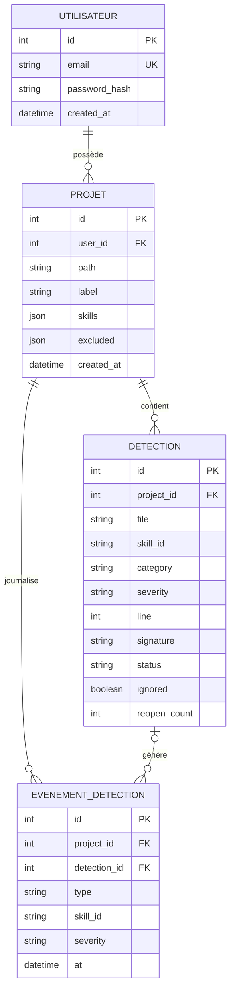

# Modélisation de la Base de Données - Projet Redline

> **Projet Fil Rouge - Bachelor 3 Développement**
> Jalon 3 - Modélisation de la base de données (méthode MERISE)
>
> **Auteur :** Badirou Mohamed Yecir
> **Formation :** Bachelor 3 Développement - IPSSI
> **Date :** [à compléter]
> **Version :** 1.1

---

## Sommaire

1. [Introduction à la méthode MERISE](#1-introduction-à-la-méthode-merise)
2. [Dictionnaire des données](#2-dictionnaire-des-données)
3. [Modèle Conceptuel de Données (MCD)](#3-modèle-conceptuel-de-données-mcd)
4. [Modèle Logique de Données (MLD)](#4-modèle-logique-de-données-mld)
5. [Modèle Physique de Données (MPD)](#5-modèle-physique-de-données-mpd)
6. [Justifications et normalisation](#6-justifications-et-normalisation)

---

## 1. Introduction à la méthode MERISE

Conformément à la méthode MERISE, la modélisation est abordée en trois étapes
successives :

1. **Modèle Conceptuel de Données (MCD)** - représentation abstraite des entités
   métier et de leurs associations, indépendante de toute technologie.
2. **Modèle Logique de Données (MLD)** - traduction du MCD en modèle relationnel
   (tables, clés primaires, clés étrangères).
3. **Modèle Physique de Données (MPD)** - implémentation concrète pour le SGBD
   retenu, ici **PostgreSQL**, telle que produite par l'ORM Doctrine.

> **Note.** Les **tables** portent des noms français (`utilisateur`, `projet`…)
> tandis que les **colonnes** suivent la convention Doctrine en anglais
> `snake_case` (`password_hash`, `skill_id`…). Ce document reflète le schéma
> réellement généré par les migrations.

**Rôle de la base dans Redline.** Le moteur d'analyse est *stateless* : il analyse
un fichier et renvoie un rapport, sans rien persister. La base ne sert donc **pas**
à stocker le code, mais à conserver l'**historique des détections** dans le temps -
afin d'alimenter les tendances, le temps moyen de résolution (MTTR) et les
récurrences.

---

## 2. Dictionnaire des données

### Entité UTILISATEUR (table `utilisateur`)

| Colonne | Signification | Type | Contraintes |
|---------|---------------|------|-------------|
| id | Identifiant unique du compte | Entier auto-incrémenté | Clé primaire |
| email | Adresse e-mail de connexion | VARCHAR(255) | Unique, non nul |
| password_hash | Empreinte du mot de passe (jamais en clair) | VARCHAR(255) | Non nul |
| created_at | Date de création du compte | Horodatage | Non nul |

### Entité PROJET (table `projet`)

| Colonne | Signification | Type | Contraintes |
|---------|---------------|------|-------------|
| id | Identifiant unique du dossier surveillé | Entier auto-incrémenté | Clé primaire |
| user_id | Propriétaire du projet | Entier | Clé étrangère → utilisateur |
| path | Chemin racine du dossier surveillé | VARCHAR(500) | Non nul, unique par utilisateur |
| label | Nom d'affichage optionnel | VARCHAR(255) | Nullable |
| skills | Règles activées pour ce projet | JSON (tableau) | Non nul |
| excluded | Sous-dossiers exclus de la surveillance | JSON (tableau) | Non nul |
| created_at | Date d'ajout du projet | Horodatage | Non nul |

### Entité DETECTION (table `detection`)

| Colonne | Signification | Type | Contraintes |
|---------|---------------|------|-------------|
| id | Identifiant unique de la détection | Entier auto-incrémenté | Clé primaire |
| project_id | Projet concerné | Entier | Clé étrangère → projet |
| file | Fichier concerné (chemin relatif) | VARCHAR(500) | Non nul |
| skill_id | Règle à l'origine de la détection | VARCHAR(100) | Non nul |
| category | Catégorie (security / quality / reliability) | VARCHAR(20) | Non nul |
| severity | Gravité (critical / warning / info) | VARCHAR(20) | Non nul |
| line | Ligne du problème (1-indexée) | INTEGER | Non nul |
| snippet | Contenu de la ligne fautive | TEXT | Non nul |
| signature | Signature stable `fichier::skill::extrait` | TEXT | Unique par projet |
| status | État de vie (ACTIVE / RESOLVED) | VARCHAR (enum PHP) | Non nul, défaut = ACTIVE |
| ignored | Faux positif assumé par l'utilisateur | BOOLEAN | Non nul, défaut = faux |
| first_seen_at | Première apparition | Horodatage | Non nul |
| last_seen_at | Dernière apparition | Horodatage | Non nul |
| resolved_at | Date de résolution | Horodatage | Nullable |
| reopen_count | Nombre de réapparitions après résolution | INTEGER | Non nul, défaut = 0 |

### Entité EVENEMENT_DETECTION (table `evenement_detection`)

| Colonne | Signification | Type | Contraintes |
|---------|---------------|------|-------------|
| id | Identifiant unique de l'événement | Entier auto-incrémenté | Clé primaire |
| project_id | Projet concerné | Entier | Clé étrangère → projet |
| detection_id | Détection concernée | Entier | Clé étrangère → detection (nullable) |
| type | Nature (APPEARED / RESOLVED / REOPENED) | VARCHAR (enum PHP) | Non nul |
| skill_id | Règle concernée (dénormalisé pour l'analytique) | VARCHAR(100) | Non nul |
| severity | Gravité au moment de l'événement | VARCHAR(20) | Non nul |
| at | Horodatage de l'événement | Horodatage | Non nul |

---

## 3. Modèle Conceptuel de Données (MCD)

### 3.1 Entités et associations

Le domaine s'articule autour de **quatre entités** :

- **UTILISATEUR** possède ses propres projets (données isolées par compte).
- **PROJET** représente un dossier racine surveillé. Ses règles activées (`skills`)
  et sous-dossiers exclus (`excluded`) sont portés comme attributs multi-valués
  (stockés en JSON, voir §6).
- **DETECTION** est l'identité d'un problème détecté, avec son cycle de vie.
- **EVENEMENT_DETECTION** est un journal horodaté (append-only) qui trace chaque
  apparition, résolution ou réouverture, pour alimenter les tendances.

### 3.2 Cardinalités

| Association | Entité A | Cardinalité A | Entité B | Cardinalité B |
|-------------|----------|---------------|----------|---------------|
| possède | UTILISATEUR | (0,n) | PROJET | (1,1) |
| contient | PROJET | (0,n) | DETECTION | (1,1) |
| journalise | PROJET | (0,n) | EVENEMENT_DETECTION | (1,1) |
| génère | DETECTION | (0,n) | EVENEMENT_DETECTION | (0,1) |

Lecture : *un utilisateur possède de 0 à n projets ; un projet appartient à
exactement un utilisateur*. *Une détection génère de 0 à n événements ; un
événement se rattache à au plus une détection* (un événement de résolution peut
survivre à la suppression de sa détection, d'où le côté optionnel).

### 3.3 Diagramme conceptuel



---

## 4. Modèle Logique de Données (MLD)

Traduction du MCD en tables relationnelles. Notation : `PK` = clé primaire,
`FK` = clé étrangère.

```
UTILISATEUR (id PK, email, password_hash, created_at)
    UNIQUE (email)

PROJET (id PK, user_id FK -> UTILISATEUR, path, label, skills, excluded,
        created_at)
    UNIQUE (user_id, path)

DETECTION (id PK, project_id FK -> PROJET, file, skill_id, category, severity,
           line, snippet, signature, status, ignored, first_seen_at,
           last_seen_at, resolved_at, reopen_count)
    UNIQUE (project_id, signature)

EVENEMENT_DETECTION (id PK, project_id FK -> PROJET,
                     detection_id FK -> DETECTION (nullable), type, skill_id,
                     severity, at)
```

**Règles de transformation appliquées :**

- Chaque entité du MCD devient une table.
- Les associations *(0,n) - (1,1)* sont traduites par une clé étrangère côté « n »
  (PROJET porte `user_id` ; DETECTION porte `project_id` ; etc.).
- Les attributs multi-valués (`skills`, `excluded`) sont portés directement par
  PROJET sous forme de colonnes **JSON** (dénormalisation assumée, voir §6).
- L'association optionnelle *DETECTION (0,n) - (0,1) EVENEMENT* donne une clé
  étrangère **nullable** `detection_id` dans EVENEMENT_DETECTION.

---

## 5. Modèle Physique de Données (MPD)

Implémentation pour **PostgreSQL**, telle que générée par les migrations Doctrine.
Les identifiants sont des **entiers auto-incrémentés** (`GENERATED BY DEFAULT AS
IDENTITY`). Les énumérations métier sont des **enums PHP** persistés en `VARCHAR`
(la valeur textuelle : `ACTIVE`, `APPEARED`…), la validité étant garantie côté
application.

```sql
-- Utilisateur
CREATE TABLE utilisateur (
    id            INT GENERATED BY DEFAULT AS IDENTITY PRIMARY KEY,
    email         VARCHAR(255) NOT NULL UNIQUE,
    password_hash VARCHAR(255) NOT NULL,               -- bcrypt / argon2
    created_at    TIMESTAMP(0) WITHOUT TIME ZONE NOT NULL
);

-- Projet (dossier surveillé), unique par utilisateur
CREATE TABLE projet (
    id         INT GENERATED BY DEFAULT AS IDENTITY PRIMARY KEY,
    user_id    INT NOT NULL REFERENCES utilisateur(id) ON DELETE CASCADE,
    path       VARCHAR(500) NOT NULL,
    label      VARCHAR(255),
    skills     JSON NOT NULL,                          -- règles activées
    excluded   JSON NOT NULL,                          -- sous-dossiers exclus
    created_at TIMESTAMP(0) WITHOUT TIME ZONE NOT NULL,
    UNIQUE (user_id, path)
);

-- Détection (identité d'un problème + cycle de vie)
CREATE TABLE detection (
    id             INT GENERATED BY DEFAULT AS IDENTITY PRIMARY KEY,
    project_id     INT NOT NULL REFERENCES projet(id) ON DELETE CASCADE,
    file           VARCHAR(500) NOT NULL,
    skill_id       VARCHAR(100) NOT NULL,
    category       VARCHAR(20)  NOT NULL,
    severity       VARCHAR(20)  NOT NULL,
    line           INTEGER      NOT NULL,
    snippet        TEXT         NOT NULL,
    signature      TEXT         NOT NULL,
    status         VARCHAR(255) NOT NULL DEFAULT 'ACTIVE',   -- enum PHP DetectionStatus
    ignored        BOOLEAN      NOT NULL DEFAULT false,
    first_seen_at  TIMESTAMP(0) WITHOUT TIME ZONE NOT NULL,
    last_seen_at   TIMESTAMP(0) WITHOUT TIME ZONE NOT NULL,
    resolved_at    TIMESTAMP(0) WITHOUT TIME ZONE,
    reopen_count   INTEGER      NOT NULL DEFAULT 0,
    UNIQUE (project_id, signature)
);

CREATE INDEX idx_detection_projet_statut ON detection (project_id, status);
CREATE INDEX idx_detection_skill         ON detection (skill_id);

-- Journal horodaté (append-only) alimentant les tendances
CREATE TABLE evenement_detection (
    id           INT GENERATED BY DEFAULT AS IDENTITY PRIMARY KEY,
    project_id   INT NOT NULL REFERENCES projet(id) ON DELETE CASCADE,
    detection_id INT REFERENCES detection(id) ON DELETE SET NULL,
    type         VARCHAR(255) NOT NULL,                     -- enum PHP EventType
    skill_id     VARCHAR(100) NOT NULL,
    severity     VARCHAR(20)  NOT NULL,
    at           TIMESTAMP(0) WITHOUT TIME ZONE NOT NULL
);

CREATE INDEX idx_evenement_projet_date ON evenement_detection (project_id, at);
CREATE INDEX idx_evenement_date        ON evenement_detection (at);
```

### Choix physiques justifiés

- **Identifiants entiers auto-incrémentés** (`IDENTITY`) : standard Doctrine,
  simples et performants pour les clés et jointures.
- **`ON DELETE CASCADE`** sur PROJET et DETECTION : supprimer un utilisateur ou un
  projet purge automatiquement ses données rattachées (cohérence + RGPD).
- **`ON DELETE SET NULL`** sur `evenement_detection.detection_id` : l'historique
  d'un événement (ex. résolution) est conservé même si la détection disparaît.
- **Index** posés sur les colonnes de filtrage réel : `(project_id, status)` pour
  lister les détections actives, `(project_id, at)` et `(at)` pour tracer les
  courbes de tendance efficacement.
- **Énumérations en `VARCHAR`** : les enums PHP (`DetectionStatus`, `EventType`)
  sont persistés par leur valeur textuelle ; la validité est garantie par le
  typage applicatif plutôt que par un type ENUM PostgreSQL (portabilité accrue).

---

## 6. Justifications et normalisation

### 6.1 Adéquation aux besoins fonctionnels

- Un utilisateur peut surveiller plusieurs projets, chacun isolé (association
  *possède*, contrainte d'unicité `(user_id, path)`).
- Une détection n'est pas recréée à chaque scan : elle est identifiée par une
  **signature stable** `(project_id, signature)` et mise à jour, ce qui permet de
  suivre son cycle de vie (première vue, résolution, réouvertures).
- Le journal EVENEMENT_DETECTION, en append-only, permet de reconstituer les
  **tendances** (apparitions / résolutions par période) et de calculer le **MTTR**
  (écart entre `APPEARED` et `RESOLVED`).

### 6.2 Formes normales et dénormalisation assumée

Les entités principales (UTILISATEUR, PROJET, DETECTION, EVENEMENT_DETECTION)
respectent la **3NF** : chaque attribut non-clé dépend de la clé, de toute la clé,
et de rien d'autre que la clé.

**Exception assumée : les colonnes `skills` et `excluded`** de PROJET stockent des
**listes en JSON**, ce qui déroge à la 1re forme normale (atomicité). Ce choix est
**délibéré** : ces listes ne sont lues/écrites qu'en bloc (rejouer la configuration
d'un projet en un seul accès), jamais requêtées transversalement. La normalisation
« classique » consisterait à créer deux tables associatives
`COMPETENCE_PROJET(project_id, code_skill)` et `EXCLUSION_PROJET(project_id,
chemin)` ; elle reste possible et directe si un besoin de requêtage par règle
apparaît, mais alourdirait inutilement le modèle pour l'usage réel.

Cette décision illustre un arbitrage courant : **normaliser ce qui est requêté,
dénormaliser ce qui est manipulé en bloc.**

---

*Document rédigé dans le cadre du Jalon 3, aligné sur le schéma Doctrine réellement
généré. Il constitue le chapitre VI du rapport final et sert de fondation à la
conception back-end (entités et ORM).*
