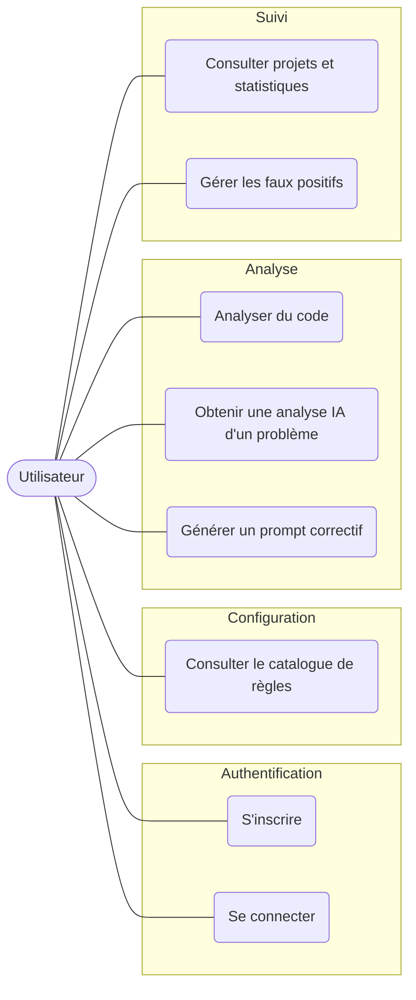
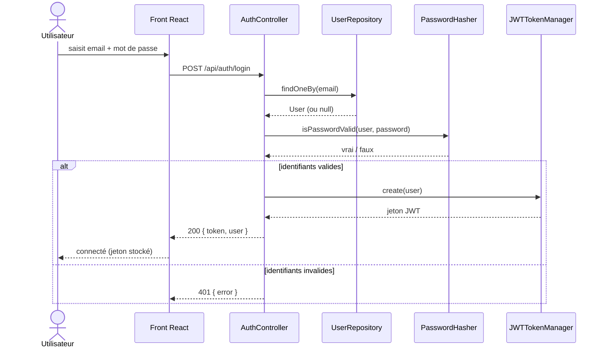
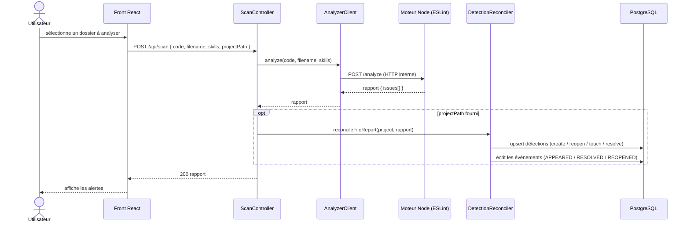
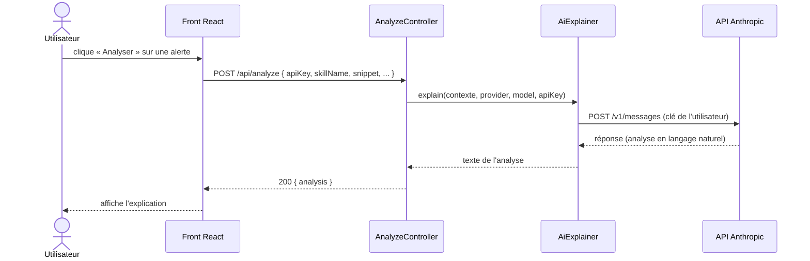
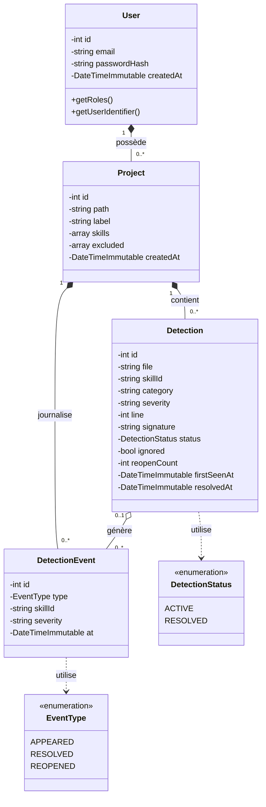
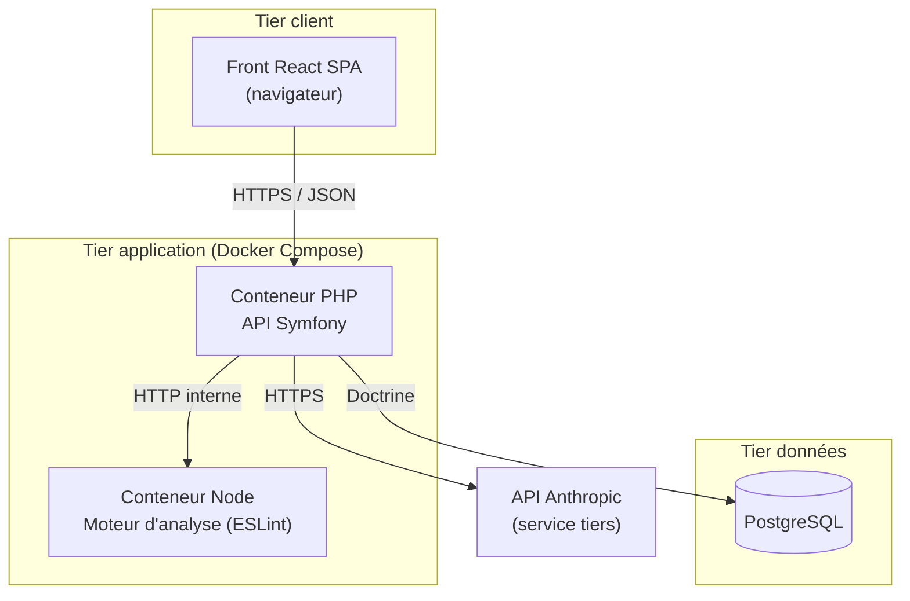

# Conception de l'Application & Architecture - Projet Redline

> **Projet Fil Rouge - Bachelor 3 Développement**
> Jalon 4 - Conception de l'application (UML) et architecture multi-couches
>
> **Auteur :** Badirou Mohamed Yecir
> **Formation :** Bachelor 3 Développement - IPSSI
> **Date :** [à compléter]
> **Version :** 1.0

---

## Sommaire

1. [Diagramme de cas d'utilisation](#1-diagramme-de-cas-dutilisation)
2. [Diagrammes de séquence](#2-diagrammes-de-séquence)
3. [Diagramme de classes](#3-diagramme-de-classes)
4. [Architecture multi-couches](#4-architecture-multi-couches)
5. [Composants externes et bibliothèques](#5-composants-externes-et-bibliothèques)

---

## 1. Diagramme de cas d'utilisation

Un seul acteur : l'**Utilisateur authentifié** (développeur, débutant ou vibe
codeur). Certaines actions publiques (consulter le catalogue) ne requièrent pas de
connexion.

| # | Cas d'utilisation | Endpoint | Accès |
|---|-------------------|----------|-------|
| UC1 | S'inscrire | `POST /api/auth/signup` | Public |
| UC2 | Se connecter | `POST /api/auth/login` | Public |
| UC3 | Consulter le catalogue de règles | `GET /api/skills` | Public |
| UC4 | Analyser du code | `POST /api/scan` | Authentifié |
| UC5 | Obtenir une analyse IA d'un problème | `POST /api/analyze` | Authentifié |
| UC6 | Générer un prompt correctif | `POST /api/generate-fix-prompt` | Authentifié |
| UC7 | Consulter projets et statistiques | `GET /api/projects`, `/api/stats/*` | Authentifié |
| UC8 | Gérer les faux positifs | `GET/POST /api/detections/*` | Authentifié |

> **Note de périmètre** : la configuration guidée (wizard : sélection des dossiers,
> détection de la stack, choix des règles) est gérée côté front et se reflète dans
> l'appel `POST /api/scan` ; la surveillance temps réel relève du moteur / de la
> version desktop. Les cas ci-dessus couvrent les interactions exposées par l'API
> Symfony.

---

## 2. Diagrammes de séquence

### 2.1 Connexion (authentification JWT)

### 2.2 Analyse de code avec persistance (cas central)

Ce diagramme illustre le principe directeur : **Symfony orchestre, le moteur Node
analyse**. Il montre la délégation au service d'analyse puis la réconciliation en
base.

### 2.3 Analyse IA d'un problème (API externe)

---

## 3. Diagramme de classes

### 3.1 Modèle du domaine (entités)

Les liens **pleins (composition ◆)** traduisent une dépendance de cycle de vie
(`ON DELETE CASCADE` : supprimer un utilisateur ou un projet purge ses données
rattachées). Le lien **creux (agrégation ◇)** entre `Detection` et
`DetectionEvent` traduit le `ON DELETE SET NULL` : un événement (ex. résolution)
**survit** à la suppression de sa détection - d'où la cardinalité `0..1` côté
détection.

### 3.2 Couches applicatives (contrôleurs, services, dépôts)

L'application suit une séparation stricte des responsabilités. Chaque contrôleur
délègue à des services métier, qui s'appuient sur des dépôts Doctrine.

| Couche | Classes | Rôle |
|--------|---------|------|
| **Contrôleurs** (HTTP) | `AuthController`, `SkillController`, `ScanController`, `ProjectController`, `StatsController`, `DetectionController`, `AnalyzeController` | Reçoivent la requête, valident les entrées, délèguent, formatent la réponse JSON |
| **Services** (métier) | `AnalyzerClient`, `DetectionReconciler`, `AnalyticsRepository`, `AiExplainer`, `PromptBuilder`, `SkillCatalog` | Logique métier : orchestration du moteur, réconciliation, agrégations, appel IA |
| **Dépôts** (données) | `UserRepository`, `ProjectRepository`, `DetectionRepository`, `DetectionEventRepository` | Accès aux entités via Doctrine ORM |
| **Entités** (modèle) | `User`, `Project`, `Detection`, `DetectionEvent` (+ enums) | Représentation persistante du domaine |

Exemples de collaborations clés :
- `ScanController` → `AnalyzerClient` (appel du moteur) puis `DetectionReconciler`
  (persistance).
- `DetectionReconciler` → `EntityManager` + `ProjectRepository` +
  `DetectionRepository`.
- `AnalyzeController` → `AiExplainer` → API Anthropic.
- `StatsController` / `ProjectController` / `DetectionController` →
  `AnalyticsRepository` (SQL agrégé scopé par utilisateur).

---

## 4. Architecture multi-couches

### 4.1 Architecture logique (MVC + services)

L'application respecte le pattern **MVC** de Symfony, enrichi d'une **couche de
services** métier :

- **Modèle** : les entités Doctrine (`User`, `Project`, `Detection`,
  `DetectionEvent`) et leur persistance en base.
- **Vue** : l'application front **React** (SPA) consommant l'API ; côté serveur,
  les réponses sont du **JSON** (API REST, pas de Twig).
- **Contrôleur** : les contrôleurs Symfony, qui ne contiennent **aucune logique
  métier** - ils délèguent aux services.
- **Services** : la logique métier isolée (réconciliation, analyse, agrégations),
  testable et réutilisable.

Principe directeur : **le moteur d'analyse est découplé du framework.** Symfony
orchestre (authentification, persistance, sécurité, API) et **délègue l'analyse
proprement dite à un moteur Node** (ESLint), appelé en HTTP interne. Ajouter un
langage/framework revient à enrichir le moteur, sans toucher au backend.

### 4.2 Architecture n-tiers (déploiement)

- **Tier client** : le navigateur exécutant la SPA React.
- **Tier application** : deux conteneurs orchestrés par **Docker Compose** - l'API
  Symfony (PHP) et le moteur d'analyse (Node). Le moteur n'est pas exposé
  publiquement : il n'est joignable que par Symfony sur le réseau interne Docker.
- **Tier données** : PostgreSQL (conteneur dédié, volume persistant).
- **Service tiers** : l'API Anthropic, appelée avec la clé de l'utilisateur.

> Distinction couche logique / tier physique : les couches logiques (contrôleurs,
> services, données) peuvent tourner sur un même hôte ; il s'agit néanmoins d'une
> architecture n-tiers, séparée par conteneurs.

### 4.3 Séparation des responsabilités et bonnes pratiques

- **Single Responsibility** : chaque service a une responsabilité unique
  (`DetectionReconciler` = cycle de vie ; `AnalyticsRepository` = lecture agrégée ;
  `AiExplainer` = appel IA).
- **Contrôleurs fins** : aucune logique métier dans les contrôleurs.
- **Injection de dépendances** : services injectés via l'autowiring Symfony.
- **Secrets isolés** : clés/jetons hors du code (variables d'environnement), clé
  privée JWT hors dépôt.
- **Conventions** : PSR-12, typage strict PHP 8.
- **Design patterns** : *Adapter* (`AnalyzerClient` masque le moteur Node externe
  derrière une interface simple), *Strategy* (`AiExplainer` conçu pour accueillir
  plusieurs fournisseurs d'IA interchangeables), *Registry* (catalogue de skills),
  et *injection de dépendances* omniprésente (autowiring Symfony).

---

## 5. Composants externes et bibliothèques

| Composant | Rôle |
|-----------|------|
| **Doctrine ORM** | Mapping objet-relationnel, requêtes paramétrées (anti-injection) |
| **LexikJWTAuthenticationBundle** | Émission et vérification des jetons JWT |
| **NelmioCorsBundle** | Gestion des en-têtes CORS (front sur origine distincte) |
| **Symfony RateLimiter** | Limitation des tentatives de connexion (anti-brute-force) |
| **Symfony HttpClient** | Appels HTTP au moteur Node et à l'API Anthropic |
| **Moteur Node (ESLint)** | Service d'analyse statique découplé (les 8 skills) |
| **API Anthropic** | Analyse contextuelle IA à la demande (API tierce) |
| **Docker / Docker Compose** | Conteneurisation et orchestration des services |
| **PHPUnit** | Tests unitaires, fonctionnels et d'intégration |

---

*Document rédigé dans le cadre du Jalon 4. Il constitue le chapitre VII
(Conception de l'application) et VIII (Architecture multi-couches) du rapport
final. Les diagrammes sont fournis en Mermaid ; à l'export PDF, les remplacer par
des images rendues.*
