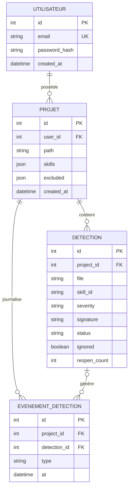
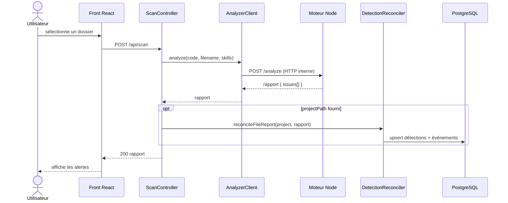
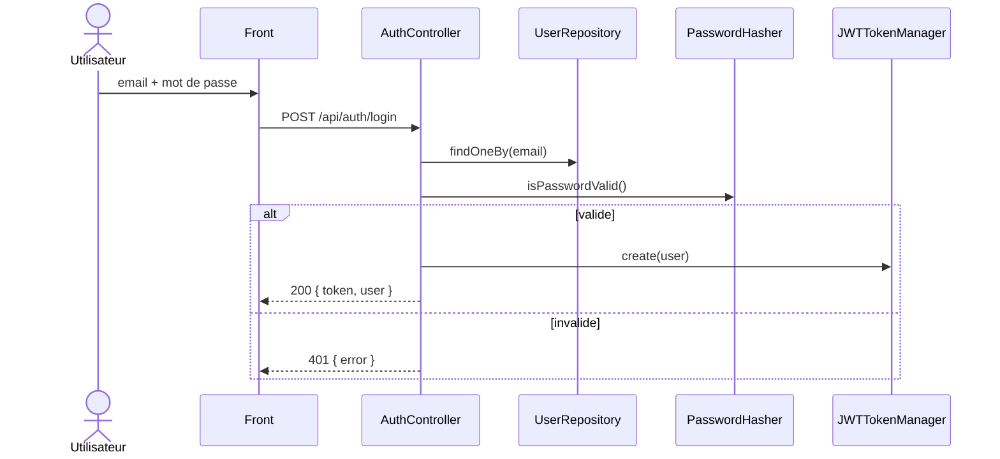
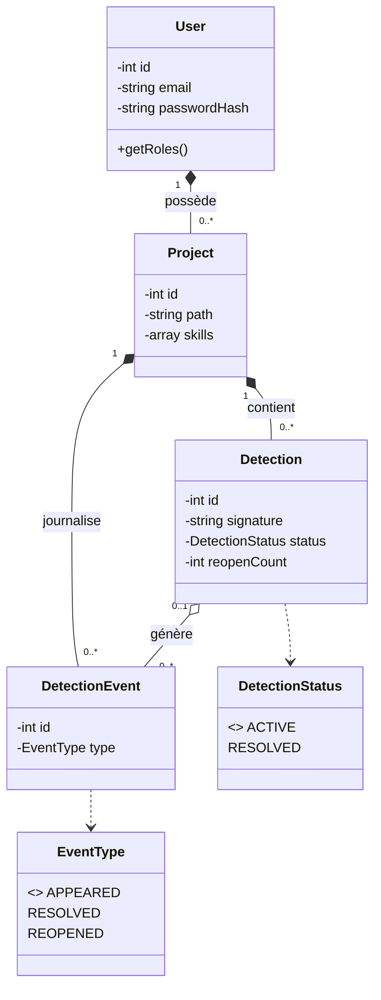
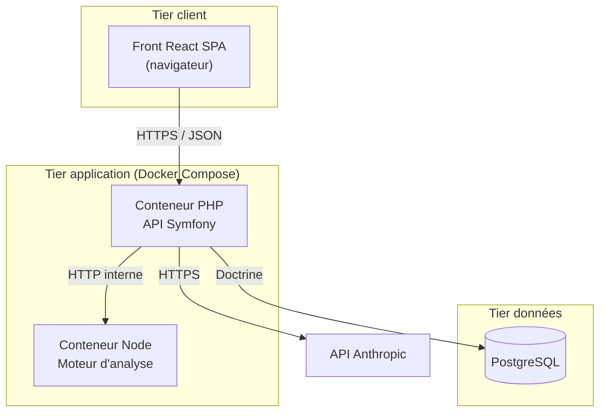

# Redline - Outil de revue de code généré par IA

### Mémoire de projet fil rouge

---

**Auteur :** Badirou Mohamed Yecir
**Formation :** Bachelor 3 Développement - IPSSI
**Titre visé :** Concepteur Développeur d'Applications (CDA)
**Année :** 2025 - 2026
**Date de soutenance :** [à compléter]

---

<div style="page-break-after: always;"></div>

## Sommaire

- [Remerciements](#remerciements)
- [I. Presentation (English)](#i-presentation-english)
- [II. Présentation du projet](#ii-présentation-du-projet)
- [III. Cahier des charges](#iii-cahier-des-charges)
- [IV. Méthodologie et organisation](#iv-méthodologie-et-organisation)
- [V. Conception UI/UX](#v-conception-uiux)
- [VI. Modélisation de la base de données](#vi-modélisation-de-la-base-de-données)
- [VII. Conception de l'application](#vii-conception-de-lapplication)
- [VIII. Architecture multi-couches](#viii-architecture-multi-couches)
- [IX. Sécurité](#ix-sécurité)
- [X. Politique de tests](#x-politique-de-tests)
- [XI. Déploiement et mise en production](#xi-déploiement-et-mise-en-production)
- [XII. Veille technologique](#xii-veille-technologique)
- [XIII. Veille sécurité](#xiii-veille-sécurité)
- [XIV. Difficultés rencontrées](#xiv-difficultés-rencontrées)
- [XV. Conclusion et ouverture](#xv-conclusion-et-ouverture)
- [XVI. Annexes](#xvi-annexes)

> **Note de lecture.** Les diagrammes de ce document sont fournis au format Mermaid.
> Pour la version papier, ils sont à rendre en images (via mermaid.live) et à
> insérer aux emplacements indiqués.

<div style="page-break-after: always;"></div>

---

## Remerciements

Je tiens à remercier l'ensemble de l'équipe pédagogique de l'IPSSI pour son
accompagnement tout au long de ce projet fil rouge, ainsi que mon formateur
référent pour ses retours et la validation des différents jalons. Je remercie
également mes camarades de promotion pour leurs échanges et leurs retours sur
l'interface et l'ergonomie du produit.

*(À personnaliser : noms de l'encadrant, collaborateurs, ressources ayant aidé.)*

<div style="page-break-after: always;"></div>

---

## I. Presentation (English)

### Personal introduction

My name is Badirou Mohamed Yecir, and I am a third-year Development student at
IPSSI, preparing the "Concepteur Développeur d'Applications" (CDA) certification.
I am passionate about software architecture, developer tooling, and the rise of
AI-assisted programming. Through this final project, I wanted to build something
at the intersection of these interests: a tool that helps developers ship safer
code in the age of AI code generation.

### Project overview in English

**Redline** is an automated review tool for AI-generated code. As developers -
including beginners and "vibe coders" - increasingly rely on AI assistants
(Cursor, Copilot, Claude, and others) to produce code, that code is written faster
than it is reviewed. It often hides security and quality issues: hardcoded API
keys, SQL injections, cross-site scripting, missing error handling, and so on.

Redline continuously watches a project, analyses its code against rules grouped
into "skills" (security, quality, reliability), explains each detected problem, and
generates a structured correction prompt to send back to the AI. The loop repeats
until the code is clean.

Its architecture is built around a **decoupled analysis engine**: a Symfony (PHP)
backend orchestrates authentication, persistence, security and the API, while a
Node.js engine (based on ESLint) performs the actual static analysis. A React
single-page application provides a real-time dashboard, and the whole system is
containerised with Docker.

Key technologies: **Symfony 7 (PHP 8.2), React (Vite, TypeScript), PostgreSQL,
Doctrine ORM, Node.js/ESLint, JWT authentication, Docker, GitHub Actions CI, and
the Anthropic API** for contextual AI analysis.

> Après cette présentation liminaire, entrons dans le détail du projet, de son
> contexte et de la problématique à laquelle il répond.

<div style="page-break-after: always;"></div>

---

## II. Présentation du projet

### 2.1 Contexte et problématique

La génération de code par intelligence artificielle (Claude, Cursor, GitHub
Copilot, Lovable, Replit…) est devenue une pratique courante, y compris chez des
développeurs juniors et des profils non-techniques (« vibe coders ») qui produisent
des applications entières en dialoguant avec une IA. Cette accélération a un revers :
**le code généré est produit plus vite qu'il n'est relu**, et son auteur n'a souvent
ni le temps, ni parfois les compétences, pour en évaluer la sûreté.

Le code généré contient régulièrement des défauts invisibles à l'œil non averti :
secrets d'API codés en dur, requêtes SQL vulnérables aux injections, failles XSS,
configurations CORS trop permissives, absence de gestion d'erreurs. Ces problèmes
passent d'autant plus facilement que :

- l'auteur **fait confiance** au code généré et ne le relit pas en profondeur ;
- les outils d'analyse existants (ESLint, SonarQube) produisent des messages
  **techniques et cryptiques**, peu exploitables par un débutant ;
- surtout, ces outils **s'arrêtent au diagnostic** : ils listent les problèmes mais
  ne referment jamais la boucle avec l'IA qui a écrit le code.

**Problématique.** Comment aider un développeur - et en particulier un débutant qui
génère du code par IA - à détecter, comprendre et corriger automatiquement les
failles de son code, sans expertise préalable en sécurité ?

### 2.2 Solution développée

**Redline** répond à ce besoin : il surveille un projet, analyse le code contre des
règles regroupées en « skills », explique chaque problème détecté (analyse
déterministe + analyse IA contextuelle), et génère un **prompt correctif structuré**
à renvoyer à l'IA. Le cycle se répète jusqu'à validation, avec un garde-fou
anti-boucle-infinie.

Le principe directeur est un **moteur d'analyse central découplé du framework** :
ajouter le support d'un langage ou d'un framework ne touche jamais au cœur du
système, seulement un module de règles.

### 2.3 Technologies utilisées

| Domaine | Technologie |
|---------|-------------|
| Back-end / API | PHP 8.2, **Symfony 7** |
| Front-end | **React 18**, Vite, TypeScript, Tailwind CSS |
| Base de données | **PostgreSQL 16**, Doctrine ORM |
| Moteur d'analyse | **Node.js**, ESLint |
| Authentification | JWT (LexikJWTAuthenticationBundle), bcrypt/argon2 |
| API externe | **API Anthropic** (analyse IA contextuelle) |
| Conteneurisation | **Docker**, Docker Compose |
| Qualité / CI | PHPUnit, PHPStan, **GitHub Actions** |

> Ayant posé le contexte et la solution, la première étape formelle du projet a été
> de rédiger le cahier des charges fonctionnel.

<div style="page-break-after: always;"></div>

---

## III. Cahier des charges

### 3.1 Objectifs du projet

**Objectifs principaux :**

- **Détecter automatiquement** les problèmes de sécurité, de qualité et de
  robustesse dans le code généré par IA, via un moteur de règles extensible.
- **Rendre les problèmes compréhensibles** grâce à une explication contextuelle
  (déterministe + analyse IA à la demande), et non un simple code d'erreur.
- **Refermer la boucle avec l'IA** en générant un prompt correctif structuré.
- **Surveiller le code en temps réel** et présenter les alertes dans un tableau de
  bord clair, groupées par sévérité, avec suivi des tendances.

**Objectifs quantitatifs (SMART) :**

| # | Objectif | Mesure de réussite |
|---|----------|--------------------|
| O1 | Couvrir Sécurité / Qualité / Robustesse | ≥ 8 règles opérationnelles et testées |
| O2 | Fiabilité des détections | Résultats confrontés à ESLint / OWASP |
| O3 | Réactivité de l'analyse | Analyse d'un fichier restituée en < 2 s |
| O4 | Boucle de correction | Chaîne détection → prompt correctif fonctionnelle |
| O5 | Qualité logicielle | Tests automatisés au vert, CI opérationnelle |
| O6 | Déployabilité | Application lançable via `docker compose up` |

### 3.2 Contexte métier

Le domaine est celui du **développement assisté par IA**. Les utilisateurs cibles
sont :

- des **développeurs débutants** qui apprennent avec une IA ;
- des **« vibe coders »** (profils non techniques) qui construisent des applications
  en dialoguant avec une IA ;
- des **développeurs confirmés** souhaitant un garde-fou automatique sur le code
  produit par leurs agents IA.

### 3.3 Exigences fonctionnelles

| # | Fonctionnalité | Description |
|---|----------------|-------------|
| F1 | Authentification | Création de compte, connexion, session sécurisée (JWT), isolation des données par utilisateur |
| F2 | Configuration guidée | Assistant multi-étapes : dossiers → stack → sous-dossiers → clé API → skills |
| F3 | Connexion du code | Sélection de dossiers à surveiller (fenêtre native du navigateur) |
| F4 | Détection de la stack | Reconnaissance automatique du langage/framework |
| F5 | Sélection des règles | Activation/désactivation des skills par catégorie et sévérité |
| F6 | Analyse par règles | Moteur appliquant les skills et produisant un rapport structuré |
| F7 | Surveillance temps réel | Détection continue des modifications et flux d'alertes live |
| F8 | Tableau de bord | Alertes groupées par sévérité, graphe de tendance, filtres |
| F9 | Analyse IA | Explication approfondie d'un problème à la demande (API externe) |
| F10 | Prompt correctif | Génération d'un prompt structuré à copier vers l'IA |
| F11 | Faux positifs | Marquer une détection comme ignorée, restaurer |
| F12 | Historique et analytique | Projets, tendances, MTTR, récurrences |

### 3.4 Exigences techniques

- **Back-end :** API REST Symfony (PHP).
- **Front-end :** SPA React (Vite, TypeScript, Tailwind).
- **Base de données :** PostgreSQL, modélisée en MERISE, via l'ORM Doctrine.
- **API externe :** API Anthropic (analyse IA).
- **Conteneurisation :** Docker / Docker Compose.
- **Qualité :** tests automatisés (PHPUnit), analyse statique (PHPStan), CI
  (GitHub Actions), sécurité OWASP.

### 3.5 Contraintes temporelles

Projet mené sur **6 mois**, découpé en 6 jalons mensuels (cahier des charges,
conception, modélisation, développement, tests, déploiement), avec une soutenance
orale finale.

> Le cahier des charges validé, il fallait choisir comment organiser et piloter la
> réalisation.

<div style="page-break-after: always;"></div>

---

## IV. Méthodologie et organisation

### 4.a Gestion de projet (méthode, planning, outils)

Le projet est piloté selon une approche **agile de type Kanban**, adaptée à un
travail en solo. Chaque jalon est traité comme un **sprint mensuel** avec un
livrable défini. Un **journal de bord** remplace les cérémonies Scrum.

**Planning (macro-planning) :**

| Mois | Jalon | Lots de travaux |
|------|-------|-----------------|
| Janvier | Cadrage | Cahier des charges fonctionnel |
| Février | Conception amont | Méthodologie, charte, maquettes |
| Mars | Données | Modélisation MERISE |
| Avril | Architecture | UML, architecture, début du développement |
| Mai | Réalisation | Développement, tests, sécurité (bêta) |
| Juin | Livraison | Finalisation, dockerisation, déploiement |

**Outils de suivi :** tableau Kanban (GitHub Projects), issues GitHub, revue
hebdomadaire d'avancement.

### 4.b Versionning (Git, stratégie de branches)

La gestion de version suit une stratégie **GitFlow simplifiée** :

- `main` : versions stables, taguées à chaque jalon (`v0.1`, … `v1.0`) ;
- `develop` : branche d'intégration ;
- `feature/*` : une branche par fonctionnalité, fusionnée dans `develop` via
  **pull request**.

Conventions de commit : **Conventional Commits** (`feat:`, `fix:`, `chore:`,
`test:`, `ci:`, `docs:`). Chaque fonctionnalité du backend Symfony a été développée
sur sa propre branche puis fusionnée via PR (`feature/setup`, `feature/database`,
`feature/auth`, `feature/skills`, `feature/scan-engine`, `feature/persistence`,
`feature/analytics`, `feature/ai-analyze`, `feature/security`, `feature/fix-prompt`,
`feature/front-integration`, `ci/phpstan`, `docs/*`).

### 4.c DevOps (CI/CD)

**Intégration continue (CI).** Une pipeline **GitHub Actions** s'exécute à chaque
push et pull request : elle monte un PostgreSQL éphémère, installe PHP 8.2 et les
dépendances, génère la clé JWT, exécute l'**analyse statique PHPStan** puis la
**suite de tests PHPUnit**. Tout échec fait échouer le build : les régressions sont
détectées immédiatement.

**Déploiement continu (CD).** Le projet fournit un `docker-compose.yml` lançant
l'ensemble en une commande, ainsi qu'une procédure de mise en production
documentée (chapitre XI). Une automatisation complète (build d'image + déploiement)
est envisagée comme évolution.

> Avec une organisation claire et une méthode de travail définie, je me suis lancé
> dans la conception de l'interface et de l'expérience utilisateur.

<div style="page-break-after: always;"></div>

---

## V. Conception UI/UX

### 5.a Zoning

*(Maquette Figma - voir annexe.)* L'écran de surveillance (dashboard) se décompose
en trois zones : une barre supérieure (projet actif, compte), une sidebar (dossiers
surveillés + skills par catégorie avec compteurs) et une zone principale (graphe de
tendance en haut, flux d'alertes en dessous).

### 5.b Wireframes

*(Maquettes basse fidélité Figma - voir annexe.)* Les wireframes couvrent les écrans
clés : authentification, étapes du wizard de configuration, et le dashboard avec une
alerte dépliée (extrait de code, analyse, actions).

### 5.c Charte graphique

L'identité visuelle repose sur une **palette terreuse** et un accent **terracotta**,
choisis pour signaler les alertes sans l'agressivité d'un rouge vif.

**Couleurs (thème clair) :**

| Rôle | Usage | Code |
|------|-------|------|
| Primary (accent) | Boutons, alertes | `#c0392b` (terracotta) |
| Accent | Survols | `#d4500a` (orange brûlé) |
| Background | Fond général | `#f5f0e8` (crème) |
| Card | Panneaux | `#ede7da` |
| Foreground | Texte | `#2a1f14` (brun foncé) |
| Muted | Texte secondaire | `#8a7a6a` |

Couleurs de graphiques : `#c0392b`, `#d4500a`, `#c49a2a`, `#5a8a3a`, `#3a6a8a`.

**Typographie :** **Outfit** (interface) et **JetBrains Mono** (extraits de code).
Rayon de bordure 6 px. Un **thème sombre** complet est également défini.

### 5.d Maquettes graphiques (desktop et mobile)

*(Maquettes haute fidélité Figma, desktop + mobile - voir annexe.)* Elles
correspondent à l'interface réelle développée en React, qui applique la charte
ci-dessus. La conception initiale a servi de cahier des charges UI, puis a été
implémentée et refactorisée.

**Considérations UX :** parcours en deux temps (wizard guidé puis dashboard),
transparence du périmètre (l'utilisateur voit les règles actives), retours visuels
par sévérité, interface responsive et mode sombre.

> Une fois l'interface conçue, la fondation technique du produit devait être posée :
> la modélisation de la base de données.

<div style="page-break-after: always;"></div>

---

## VI. Modélisation de la base de données

### 6.a Introduction à la méthode MERISE

La modélisation suit MERISE en trois étapes : **MCD** (conceptuel), **MLD**
(logique / relationnel) et **MPD** (physique / PostgreSQL). Le moteur d'analyse
étant *stateless*, la base ne stocke **pas** le code, mais l'**historique des
détections** (pour les tendances, le MTTR et les récurrences).

> Les tables portent des noms français (`utilisateur`, `projet`…) ; les colonnes
> suivent la convention Doctrine en anglais `snake_case`.

### 6.b Dictionnaire des données

**UTILISATEUR (`utilisateur`)** : id (entier, PK), email (unique), password_hash,
created_at.

**PROJET (`projet`)** : id (PK), user_id (FK), path (unique par utilisateur), label
(nullable), skills (JSON), excluded (JSON), created_at.

**DETECTION (`detection`)** : id (PK), project_id (FK), file, skill_id, category,
severity, line, snippet, signature (unique par projet), status (enum ACTIVE/
RESOLVED), ignored (booléen), first_seen_at, last_seen_at, resolved_at (nullable),
reopen_count.

**EVENEMENT_DETECTION (`evenement_detection`)** : id (PK), project_id (FK),
detection_id (FK nullable), type (enum APPEARED/RESOLVED/REOPENED), skill_id,
severity, at.

### 6.c Modèle Conceptuel de Données (MCD)

Cardinalités :

| Association | Entité A | Card. A | Entité B | Card. B |
|-------------|----------|---------|----------|---------|
| possède | UTILISATEUR | (0,n) | PROJET | (1,1) |
| contient | PROJET | (0,n) | DETECTION | (1,1) |
| journalise | PROJET | (0,n) | EVENEMENT | (1,1) |
| génère | DETECTION | (0,n) | EVENEMENT | (0,1) |



### 6.d Modèle Logique de Données (MLD)

```
UTILISATEUR (id PK, email, password_hash, created_at) UNIQUE (email)
PROJET (id PK, user_id FK -> UTILISATEUR, path, label, skills, excluded,
        created_at) UNIQUE (user_id, path)
DETECTION (id PK, project_id FK -> PROJET, file, skill_id, category, severity,
           line, snippet, signature, status, ignored, first_seen_at,
           last_seen_at, resolved_at, reopen_count) UNIQUE (project_id, signature)
EVENEMENT_DETECTION (id PK, project_id FK -> PROJET,
                     detection_id FK -> DETECTION (nullable), type, skill_id,
                     severity, at)
```

### 6.e Modèle Physique de Données (MPD)

```sql
CREATE TABLE utilisateur (
    id INT GENERATED BY DEFAULT AS IDENTITY PRIMARY KEY,
    email VARCHAR(255) NOT NULL UNIQUE,
    password_hash VARCHAR(255) NOT NULL,
    created_at TIMESTAMP(0) WITHOUT TIME ZONE NOT NULL
);
CREATE TABLE projet (
    id INT GENERATED BY DEFAULT AS IDENTITY PRIMARY KEY,
    user_id INT NOT NULL REFERENCES utilisateur(id) ON DELETE CASCADE,
    path VARCHAR(500) NOT NULL, label VARCHAR(255),
    skills JSON NOT NULL, excluded JSON NOT NULL,
    created_at TIMESTAMP(0) WITHOUT TIME ZONE NOT NULL,
    UNIQUE (user_id, path)
);
CREATE TABLE detection (
    id INT GENERATED BY DEFAULT AS IDENTITY PRIMARY KEY,
    project_id INT NOT NULL REFERENCES projet(id) ON DELETE CASCADE,
    file VARCHAR(500) NOT NULL, skill_id VARCHAR(100) NOT NULL,
    category VARCHAR(20) NOT NULL, severity VARCHAR(20) NOT NULL,
    line INTEGER NOT NULL, snippet TEXT NOT NULL, signature TEXT NOT NULL,
    status VARCHAR(255) NOT NULL DEFAULT 'ACTIVE',
    ignored BOOLEAN NOT NULL DEFAULT false,
    first_seen_at TIMESTAMP(0) WITHOUT TIME ZONE NOT NULL,
    last_seen_at TIMESTAMP(0) WITHOUT TIME ZONE NOT NULL,
    resolved_at TIMESTAMP(0) WITHOUT TIME ZONE,
    reopen_count INTEGER NOT NULL DEFAULT 0,
    UNIQUE (project_id, signature)
);
CREATE INDEX idx_detection_projet_statut ON detection (project_id, status);
CREATE INDEX idx_detection_skill ON detection (skill_id);
CREATE TABLE evenement_detection (
    id INT GENERATED BY DEFAULT AS IDENTITY PRIMARY KEY,
    project_id INT NOT NULL REFERENCES projet(id) ON DELETE CASCADE,
    detection_id INT REFERENCES detection(id) ON DELETE SET NULL,
    type VARCHAR(255) NOT NULL, skill_id VARCHAR(100) NOT NULL,
    severity VARCHAR(20) NOT NULL,
    at TIMESTAMP(0) WITHOUT TIME ZONE NOT NULL
);
CREATE INDEX idx_evenement_projet_date ON evenement_detection (project_id, at);
CREATE INDEX idx_evenement_date ON evenement_detection (at);
```

**Choix de conception.** `ON DELETE CASCADE` (purge RGPD à la suppression d'un
compte), `ON DELETE SET NULL` sur les événements (l'historique survit à la
détection), index sur les colonnes de filtrage réel. Les listes `skills`/`excluded`
sont stockées en JSON (dénormalisation assumée : elles sont manipulées en bloc,
jamais requêtées transversalement) - illustration de l'arbitrage « normaliser ce
qui est requêté, dénormaliser ce qui est manipulé en bloc ».

> La base modélisée, il fallait concevoir la logique applicative qui l'exploite.

<div style="page-break-after: always;"></div>

---

## VII. Conception de l'application

### 7.1 Diagrammes de cas d'utilisation

Acteur unique : l'**Utilisateur authentifié** (certaines actions publiques ne
requièrent pas de connexion).

| # | Cas d'utilisation | Endpoint | Accès |
|---|-------------------|----------|-------|
| UC1 | S'inscrire | `POST /api/auth/signup` | Public |
| UC2 | Se connecter | `POST /api/auth/login` | Public |
| UC3 | Consulter le catalogue de règles | `GET /api/skills` | Public |
| UC4 | Analyser du code | `POST /api/scan` | Authentifié |
| UC5 | Analyse IA d'un problème | `POST /api/analyze` | Authentifié |
| UC6 | Générer un prompt correctif | `POST /api/generate-fix-prompt` | Authentifié |
| UC7 | Consulter projets et statistiques | `GET /api/projects`, `/api/stats/*` | Authentifié |
| UC8 | Gérer les faux positifs | `GET/POST /api/detections/*` | Authentifié |

### 7.2 Diagrammes de séquence

**Analyse de code avec persistance** (cas central - « Symfony orchestre, le moteur
Node analyse ») :



**Connexion (JWT) :**



### 7.3 Diagramme de classes UML



Les liens **pleins (composition)** traduisent une dépendance de cycle de vie
(`ON DELETE CASCADE`) ; le lien **creux (agrégation)** entre `Detection` et
`DetectionEvent` traduit le `ON DELETE SET NULL` (l'événement survit à sa
détection).

> Cette conception s'inscrit dans une architecture claire, décrite au chapitre
> suivant.

<div style="page-break-after: always;"></div>

---

## VIII. Architecture multi-couches

### 8.1 Modèle MVC (couche logique)

L'application respecte le pattern **MVC** de Symfony, enrichi d'une **couche de
services** :

- **Modèle** : entités Doctrine et leur persistance.
- **Vue** : le front React (côté serveur, réponses JSON - pas de Twig).
- **Contrôleur** : les contrôleurs Symfony, **sans logique métier**.
- **Services** : la logique métier isolée (réconciliation, analyse, agrégations).

| Couche | Classes |
|--------|---------|
| Contrôleurs | Auth, Skill, Scan, Project, Stats, Detection, Analyze |
| Services | AnalyzerClient, DetectionReconciler, AnalyticsRepository, AiExplainer, PromptBuilder, SkillCatalog |
| Dépôts | UserRepository, ProjectRepository, DetectionRepository, DetectionEventRepository |
| Entités | User, Project, Detection, DetectionEvent |

**Design patterns** : *Adapter* (`AnalyzerClient` masque le moteur Node), *Strategy*
(`AiExplainer` prévu pour plusieurs fournisseurs d'IA), *Registry* (catalogue de
skills), *injection de dépendances* (autowiring Symfony).

### 8.2 Architecture n-tiers (tiers physiques)



Le principe directeur : **le moteur d'analyse est découplé du framework.** Symfony
orchestre (auth, persistance, sécurité, API) et délègue l'analyse au moteur Node
(ESLint) en HTTP interne. Le moteur n'est jamais exposé publiquement.

> Attention à la distinction : les couches logiques (contrôleurs, services, données)
> peuvent tourner sur un même hôte ; il s'agit néanmoins d'une architecture
> n-tiers, séparée par conteneurs.

### 8.3 Séparation des responsabilités

**Single Responsibility** (chaque service a un rôle unique), **contrôleurs fins**,
**injection de dépendances**, **secrets isolés** (variables d'environnement, clé
privée JWT hors dépôt), conventions **PSR-12** et typage strict PHP 8.

> Une architecture propre ne suffit pas : la sécurité devait être traitée
> transversalement.

<div style="page-break-after: always;"></div>

---

## IX. Sécurité

L'analyse suit le référentiel **OWASP Top 10**. Particularité : Redline étant
lui-même un outil de détection de failles, il **s'applique à son propre code** les
règles qu'il vérifie chez les autres.

### 9.a Injection XSS

L'interface React **échappe automatiquement** toute valeur dans le JSX ; aucune
injection HTML brute n'est utilisée (`dangerouslySetInnerHTML` absent du code
exécuté). L'API ne renvoie que du JSON. La règle `xss-risk` de Redline détecte
justement ce motif. **Statut : maîtrisé.**

### 9.b Injection SQL

Aucune requête par concaténation : l'accès aux données passe par **Doctrine ORM** ;
les agrégations utilisent **Doctrine DBAL** avec des **paramètres liés**. La règle
`sql-injection` (critique) détecte ce motif. **Statut : implémenté.**

### 9.c Failles CSRF

L'authentification n'utilise **pas de cookie de session** : le jeton JWT est
transmis dans l'en-tête `Authorization: Bearer`. Le navigateur ne l'attache pas
automatiquement aux requêtes inter-sites : la surface CSRF est **structurellement
neutralisée**. **Statut : maîtrisé par conception.**

### 9.d Attaques par force brute

La connexion est protégée par un **rate limiter** (5 échecs par IP en 15 minutes →
`429`), remis à zéro sur connexion réussie. Une connexion valide n'est jamais
bloquée. **Statut : implémenté.**

### 9.e Hachage des mots de passe

Les mots de passe sont hachés via le *password hasher* de Symfony (`auto` :
bcrypt/argon2, sel intégré), **jamais stockés en clair**. Les JWT sont signés en
**RS256** (clé privée/publique RSA), la clé privée n'étant jamais versionnée.
**Statut : implémenté.**

### 9.f Conformité RGPD

Données manipulées : e-mail, mot de passe haché, extraits de code. Mesures :
hachage, **suppression en cascade** (`ON DELETE CASCADE`), HTTPS en production.
À compléter : action de suppression de compte self-service et politique de
confidentialité. **Statut : partiel.**

### Configuration (CORS et en-têtes)

Le CORS est **restreint** via NelmioCorsBundle (origines de développement
uniquement) ; des **en-têtes de sécurité HTTP** (`X-Content-Type-Options: nosniff`,
`X-Frame-Options: DENY`, `Referrer-Policy: no-referrer`) sont ajoutés à toutes les
réponses.

> La sécurité en place, il fallait garantir la non-régression : c'est le rôle des
> tests.

<div style="page-break-after: always;"></div>

---

## X. Politique de tests

La stratégie suit trois niveaux : **unitaire**, **fonctionnel**, **intégration**,
avec une base PostgreSQL de test isolée (`redline_test`).

### 10.a Tests unitaires

`PromptBuilderTest` vérifie que le générateur de prompt correctif produit un texte
contenant le fichier, le skill, le message et la consigne stricte de sortie.

### 10.b Tests fonctionnels

- `SkillControllerTest` : `GET /api/skills` public, renvoie 8 règles.
- `AuthControllerTest` : parcours complet (signup 201, login 200, /me, mauvais mot
  de passe 401, accès sans jeton 401).

### 10.c Autres tests (intégration)

- `ReconciliationTest` (cœur métier) : cycle de vie complet (apparition → résolution
  → réouverture, `reopenCount = 1`).
- `AnalyticsTest` : la synthèse renvoie les bons totaux et dimensions depuis la base.

**Outils :** PHPUnit (WebTestCase, KernelTestCase), analyse statique **PHPStan**
(niveau 5). **Résultat actuel : 8 tests, 32 assertions, 100 % au vert.**

**Vérifications manuelles** (par transparence) : `/api/scan`, `/api/analyze`,
`/api/generate-fix-prompt` dépendent de services externes (moteur Node, API
Anthropic) et sont vérifiés manuellement plutôt qu'automatisés.

**CI :** un workflow GitHub Actions exécute PHPStan puis PHPUnit à chaque push (voir
chapitre IV et annexes).

> L'application testée, restait à la rendre déployable.

<div style="page-break-after: always;"></div>

---

## XI. Déploiement et mise en production

### Containerisation avec Docker

Le projet fournit un `docker-compose.yml` orchestrant **trois services** :
`database` (PostgreSQL 16), `php` (API Symfony), `engine` (moteur Node). Lancement :

```bash
docker compose up -d --build
docker compose exec php php bin/console lexik:jwt:generate-keypair --no-interaction
docker compose exec php php bin/console doctrine:migrations:migrate --no-interaction
docker compose exec php php bin/console doctrine:fixtures:load --no-interaction
cd redline && npm install && npm run dev
```

Accès : front `http://localhost:5173`, API `http://localhost:8000`, compte de démo
`demo@redline.dev` / `demo1234`.

### Environnements de déploiement

| Environnement | APP_ENV | Base | Particularités |
|---------------|---------|------|----------------|
| Développement | dev | redline | Debug, OPcache, données de démo |
| Test | test | redline_test | Base isolée (PHPUnit / CI) |
| Production | prod | dédiée | Debug désactivé, secrets régénérés, HTTPS |

**Durcissement production :** `APP_ENV=prod`, serveur PHP-FPM + Nginx (ou
FrankenPHP), base managée, clés JWT régénérées, CORS restreint à l'origine réelle,
HTTPS.

### Stratégies de mise en production

- **Blue/Green** : deux environnements, bascule du routage, retour arrière immédiat.
- **Rolling update** : mise à jour progressive sans coupure globale.
- **Fenêtre de maintenance** : plus simple, acceptable à l'échelle du projet.

> Au-delà de la réalisation, un développeur doit rester à jour : c'est l'objet de la
> veille.

<div style="page-break-after: always;"></div>

---

## XII. Veille technologique

### 12.1 Veille sur les technologies du projet

- **Symfony / PHP** : suivi des versions (Symfony 7, PHP 8.2+), des bonnes pratiques
  (attributs PHP 8, enums natifs, autowiring), via la documentation officielle, le
  blog Symfony et SymfonyCasts.
- **React / front** : évolutions de React 18, de Vite, de l'écosystème TypeScript ;
  suivi via la documentation React et les publications de l'équipe Vite.
- **Node / ESLint** : ESLint reste la référence de l'analyse statique JS/TS ; suivi
  de son API de règles (utilisée pour écrire les skills).
- **Docker** : bonnes pratiques de conteneurisation, optimisation des images et des
  montages (un point important, voir difficultés au chapitre XIV).

### 12.2 Veille sur l'IA générative de code

Le projet s'inscrit dans une tendance de fond : l'**explosion du code généré par
IA** (Copilot, Cursor, Claude, Lovable). J'ai suivi :

- l'évolution des **modèles** (familles Claude, GPT, etc.) et de leurs API ;
- l'émergence d'outils d'**agents de développement** et la question, centrale pour
  Redline, des **garde-fous de qualité** sur le code produit par ces agents ;
- les débats sur la **fiabilité et la sécurité** du code généré par IA, qui
  justifient directement l'existence du produit.

### 12.3 Veille globale du secteur

Sources régulières : agrégateurs techniques (Hacker News, dev.to), newsletters
spécialisées, documentation officielle des frameworks, et le référentiel **OWASP**
pour la sécurité applicative. Cette veille a directement orienté des choix : usage
d'ESLint pour l'analyse, PostgreSQL + Doctrine, JWT stateless, conteneurisation.

> La sécurité étant au cœur du produit, une veille spécifique lui est consacrée.

<div style="page-break-after: always;"></div>

---

## XIII. Veille sécurité

### 13.1 Analyse des menaces actuelles

Le paysage des menaces applicatives reste dominé par le **Top 10 OWASP** :
injections (SQL, commandes), XSS, mauvaise gestion de l'authentification, mauvaise
configuration (CORS, en-têtes), et de plus en plus les **composants vulnérables**
(dépendances) et les **fuites de secrets**. Une menace montante spécifique au
contexte du projet : le **code généré par IA qui introduit des failles sans que
l'auteur en ait conscience** (secrets en dur, requêtes non paramétrées).

### 13.2 Exemples concrets

- **Secret en dur** : `const API_KEY = "sk-live-…"` committé dans un dépôt public -
  exploitable en quelques minutes par des robots scannant GitHub.
- **Injection SQL** : `"SELECT * FROM users WHERE id = " + req.params.id` - permet
  d'extraire ou de détruire une base.
- **CORS permissif** : `Access-Control-Allow-Origin: *` en production - ouvre l'API
  à toute origine.

*(Captures d'écran des détections réelles de Redline sur ces motifs - voir annexe.)*

### 13.3 Mesures préventives

Redline **détecte** ces motifs (règles `hardcoded-secret`, `sql-injection`,
`cors-wildcard`, `xss-risk`) et, côté conception, **les évite lui-même** : ORM
paramétré, secrets en variables d'environnement, CORS restreint, en-têtes de
sécurité, hachage robuste, rate limiting. Cette cohérence (« l'outil applique ses
propres règles ») est un fil conducteur du projet.

> Construire ce produit n'a pas été linéaire : plusieurs obstacles techniques ont dû
> être surmontés.

<div style="page-break-after: always;"></div>

---

## XIV. Difficultés rencontrées

### 14.1 Le choix architectural : un moteur d'analyse en PHP ?

**Problème.** L'école impose un backend **Symfony (PHP)**. Or l'analyse de code
JS/TS de qualité repose sur **ESLint**, un outil **Node**. PHP ne sait pas analyser
finement du JavaScript.

**Solution.** Plutôt que de réécrire une analyse dégradée en PHP (regex), j'ai
conçu une architecture où **Symfony orchestre et délègue l'analyse à un moteur Node**
conservé comme micro-service, appelé en HTTP interne. Cette décision a transformé
une contrainte en **atout d'architecture** (le principe « moteur découplé du
framework »), et a permis de réutiliser des règles déjà écrites et testées.

**Apprentissage.** Une contrainte imposée peut devenir un choix de conception fort
si on la retourne correctement.

### 14.2 Performance de Symfony sur Docker (Windows) : ~9 s par requête

**Problème.** En développement, chaque requête à l'API prenait **~9 secondes** -
inutilisable et catastrophique pour une démonstration.

**Diagnostic.** Le serveur PHP intégré tourne en SAPI CLI (OPcache désactivé par
défaut), et surtout le dossier `vendor/` (des milliers de fichiers) était lu à
chaque requête à travers le **montage de fichiers Windows de Docker**, très lent.

**Solution.** Activation d'**OPcache** (`enable_cli`) et déplacement de `vendor/` et
`var/` dans des **volumes internes au conteneur** (système de fichiers Linux rapide)
plutôt que le montage Windows. Résultat : **de ~9 s à ~0,4 s par requête**, soit un
gain d'environ **20×**.

**Apprentissage.** Comprendre où le temps est réellement passé (ici, les entrées/
sorties fichier du montage) avant d'optimiser au hasard.

### 14.3 La clé JWT en environnement de test

**Problème.** Les tests fonctionnels échouaient (erreur d'encodage JWT), alors que
l'application fonctionnait en développement.

**Diagnostic.** Symfony **ne charge pas `.env.local` en environnement de test** (par
conception, pour des tests reproductibles). Or la passphrase de la clé JWT y était
définie : absente en test, l'encodage échouait.

**Solution.** Passage à une **clé JWT sans passphrase** (la clé privée restant, elle,
exclue du dépôt) - cohérente entre dev et test.

**Apprentissage.** Bien connaître le cycle de chargement des variables d'environnement
d'un framework.

### 14.4 Le rate limiter anti-brute-force

**Problème.** Une première implémentation ne déclenchait jamais le blocage (ou le
déclenchait de travers), et pouvait verrouiller un utilisateur légitime avec le bon
mot de passe.

**Solution.** Adoption du bon schéma : **seuls les échecs consomment un jeton**, et
une connexion réussie remet le compteur à zéro. Un mot de passe valide n'est ainsi
**jamais** bloqué, tandis que la force brute (échecs répétés) l'est après 5
tentatives.

**Apprentissage.** Un mécanisme de sécurité mal calibré peut nuire à l'utilisateur
légitime autant qu'à l'attaquant ; le comportement doit être pensé et testé.

### 14.5 L'intégration du front sur le backend Symfony

**Problème.** Le front avait été développé pour un backend Node initial ; certaines
fonctionnalités (surveillance temps réel par SSE) n'ont pas été portées sur Symfony.

**Solution.** Assumer un **périmètre clair** : la version Symfony fait de l'analyse à
la demande (le front lit les fichiers dans le navigateur puis les envoie à
`/api/scan`) ; la surveillance temps réel reste une évolution (moteur Node / version
desktop). Le CORS a été configuré pour permettre au front (origine distincte)
d'appeler l'API. La démonstration bout-en-bout (login → scan d'un dossier →
détections réelles → tableau de bord) fonctionne.

**Apprentissage.** Savoir découper et assumer un périmètre plutôt que tout vouloir
porter.

### 14.6 Obstacles organisationnels

Le projet ayant été mené en solo, le principal défi organisationnel a été de tenir
tous les rôles (conception, développement, tests, documentation) et de conserver un
historique Git propre (branches + pull requests) malgré la charge. L'usage
systématique de branches par fonctionnalité et de commits conventionnels a permis
de garder de la lisibilité.

> Ces difficultés surmontées, il est temps de dresser le bilan.

<div style="page-break-after: always;"></div>

---

## XV. Conclusion et ouverture

### 15.1 Bilan du projet

Le projet a abouti à un produit **fonctionnel et cohérent** : une application web
complète, dont le backend Symfony authentifie, analyse du code (en déléguant à un
moteur Node découplé), en historise les détections, expose des statistiques,
intègre une API d'IA externe, et applique une sécurité conforme aux principes OWASP.
L'ensemble est **conteneurisé, testé et intégré en continu** (CI verte, analyse
statique PHPStan). La démonstration de bout en bout, sur des fichiers réellement
vulnérables, valide la chaîne complète.

Les objectifs SMART fixés au cahier des charges sont atteints : plus de 8 règles
opérationnelles et testées, chaîne détection → prompt correctif fonctionnelle, tests
au vert, application déployable en une commande.

### 15.2 Perspectives d'évolution

- **Boucle de correction 100 % automatique** : le moteur possède déjà la brique
  (analyse → prompt → correction IA → ré-analyse) avec garde-fou anti-boucle ;
  l'activer serait la prochaine étape majeure.
- **Extension des skills** : ajouter des règles de niveau framework (React, Express)
  et d'autres langages, sans toucher au cœur.
- **Version desktop (Electron)** : une version locale exploitant la surveillance
  temps réel par accès disque natif.
- **Automatisation des tests des endpoints externes** (moteur, IA) via des mocks.
- **Conformité RGPD** : suppression de compte self-service, politique de
  confidentialité.

### 15.3 Compétences acquises

Ce projet m'a permis de renforcer des compétences à la fois de **développeur** et de
**concepteur** : conception d'une base de données (MERISE), modélisation UML,
architecture multi-couches et découplée, sécurité applicative (OWASP), tests
automatisés et intégration continue, conteneurisation Docker, et gestion de projet
en autonomie (Git, planification, documentation). Au-delà de la technique, j'ai
appris à **retourner des contraintes en choix de conception** et à **diagnostiquer
avant d'optimiser**.

<div style="page-break-after: always;"></div>

---

## XVI. Annexes

- **A. Documentation technique** : README du projet, procédure de lancement,
  documentation des endpoints de l'API.
- **B. Captures d'écran** :
  - l'interface réelle (wizard de configuration, tableau de bord, alertes,
    génération de prompt) ;
  - une exécution **verte de la CI** GitHub Actions (preuve de CI) ;
  - des détections réelles de Redline sur des fichiers vulnérables.
- **C. Code source significatif** :
  - le service `DetectionReconciler` (cœur de la logique de cycle de vie) ;
  - le service `AnalyzerClient` (délégation au moteur Node) ;
  - un skill du moteur (ex. `sql-injection`) ;
  - un extrait de la pipeline CI (`.github/workflows/ci.yml`).
- **D. Dépôt Git** : [lien du dépôt à insérer], release taguée `v1.0`.

---

*Fin du mémoire - version 1. Document à finaliser : rendu des diagrammes en images,
insertion des maquettes Figma et des captures d'écran, relecture orthographique,
export PDF avec numérotation des pages.*
